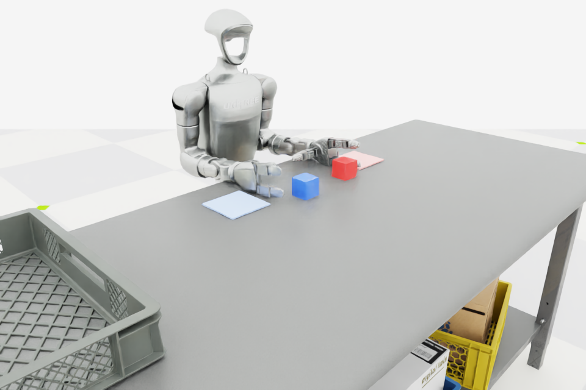
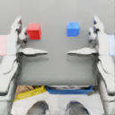
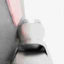
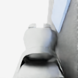
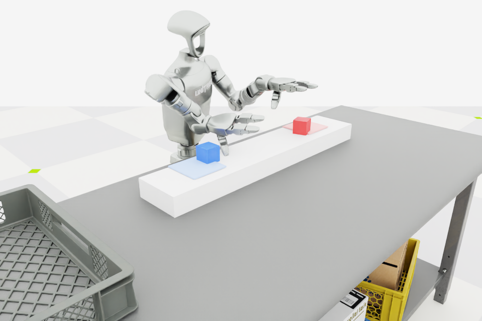

# humOID: Bimanual Cube Sorting with a Unitree G1

A simulated Unitree G1 with Dex3 hands slides a red cube onto the left pad and a blue cube onto the right pad. The scene is Isaac Sim 6.2 / Isaac Lab 3.0. The demonstrator is scripted. No ACT policy has been trained on these demonstrations, and there is no learned-policy success rate.

This repository is not the Franka lift project.

## What actually runs

- Fixed-base G1, both Dex3 hands, Pink IK on the arms, waist joints held out of the IK set.
- Action dimension 28: left wrist pose 7, right wrist pose 7, 14 hand joints.
- Three 128×128 RGB cameras: chest, left wrist, right wrist. The smoke test recorded all three.
- Scripted sorter: one hand at a time, sideways push. A palm-down grasp does not work here, because the thumb hits the table before the fingers can close on the cube.
- LeRobot v3.0 conversion and an ACT training config (`humanoid/configs/training.yaml`) are in place for when demonstrations exist.

## Screenshots

Isaac Sim frames. Not a physical robot, and not a teleoperated demonstration.





The chest frame is a 128×128 observation. In this frame the cubes are still on the platform, not on the pads.







One scripted episode in which both cubes ended on their pads. The same file is `humanoid/screenshots/sort_success.png`.

## Results that exist

From `humanoid/outputs/metrics/sim_smoke_test.json` and `humanoid/STATUS.md`:

| Item | Result |
|---|---|
| Simulation smoke test | passed |
| Action space | 28-dimensional |
| Cameras | chest, left wrist, right wrist, each 128×128 RGB |
| Scripted attempts, cubes starting off the pads | 4 successes in the first 9 |
| Saved demonstration dataset | none |
| ACT training | not run |
| Learned-policy success rate | none |

Collection is configured for 60 successful episodes (`humanoid/configs/simulation.yaml`) and has not been completed.

## Layout

```text
humanoid/simulation/     Isaac Lab env, scripted policy, collection, smoke test
humanoid/configs/        simulation.yaml, training.yaml
humanoid/screenshots/    original simulator frames
humanoid/outputs/        smoke-test metrics and camera dumps
dataset/                 HDF5 -> LeRobot v3.0 (no G1 file to convert yet)
policy/                  ACT train / evaluate / inference (not run on G1 data)
screenshots/             copies of the frames linked above
```

`dataset/synthetic_data.py` builds Franka-shaped toy trajectories for the shared conversion code. It is not a G1 dataset.

## Stack

Ubuntu 24.04, Python 3.12, Isaac Sim 6.2, Isaac Lab 3.0, Pink IK through the Isaac Lab G1 task, PyTorch, LeRobot 0.7.0. The same machine also has the Franka project; the two codebases are separate.

## Installation

Isaac Sim and Isaac Lab are not installed by `requirements.txt`. Use the Isaac Lab 3.0 / Isaac Sim 6.2 environment already used for the Franka project, or install that pair separately. Do not overwrite a system ROS, CUDA, or NVIDIA driver install.

```bash
cd humoid-g1-bimanual-sorting
python3.12 -m venv .venv && source .venv/bin/activate
pip install torch torchvision --index-url https://download.pytorch.org/whl/cu130
pip install -r requirements.txt
```

A clean install from this file was not re-run in this folder. The commands below were checked only as far as the unit tests, which do not start the simulator.

## Commands

Smoke test and collection need Isaac Sim:

```bash
python humanoid/simulation/smoke_test.py
python humanoid/simulation/collect_demonstrations.py
```

After an HDF5 exists at `humanoid/data/raw/g1_sort_scripted_demos.hdf5`:

```bash
python dataset/process_dataset.py --profile g1_sort_vision --overwrite
python dataset/validate_dataset.py --profile g1_sort_vision
python policy/train.py --profile g1_sort_vision
python policy/evaluate.py --profile g1_sort_vision
```

Do not run those last four commands yet. There is no dataset, so they cannot train or score a policy.

```bash
python -m pytest tests -q
```

## Limitations

See [docs/limitations.md](docs/limitations.md). Short version: simulation only, scripted sideways slides, 4/9 recorded scripted attempts, 60-episode collection not finished, no trained ACT policy.

Also: [docs/architecture.md](docs/architecture.md), [docs/implementation.md](docs/implementation.md). License: MIT (`LICENSE`). Unitree and NVIDIA assets stay under their own licenses and are not redistributed here.
